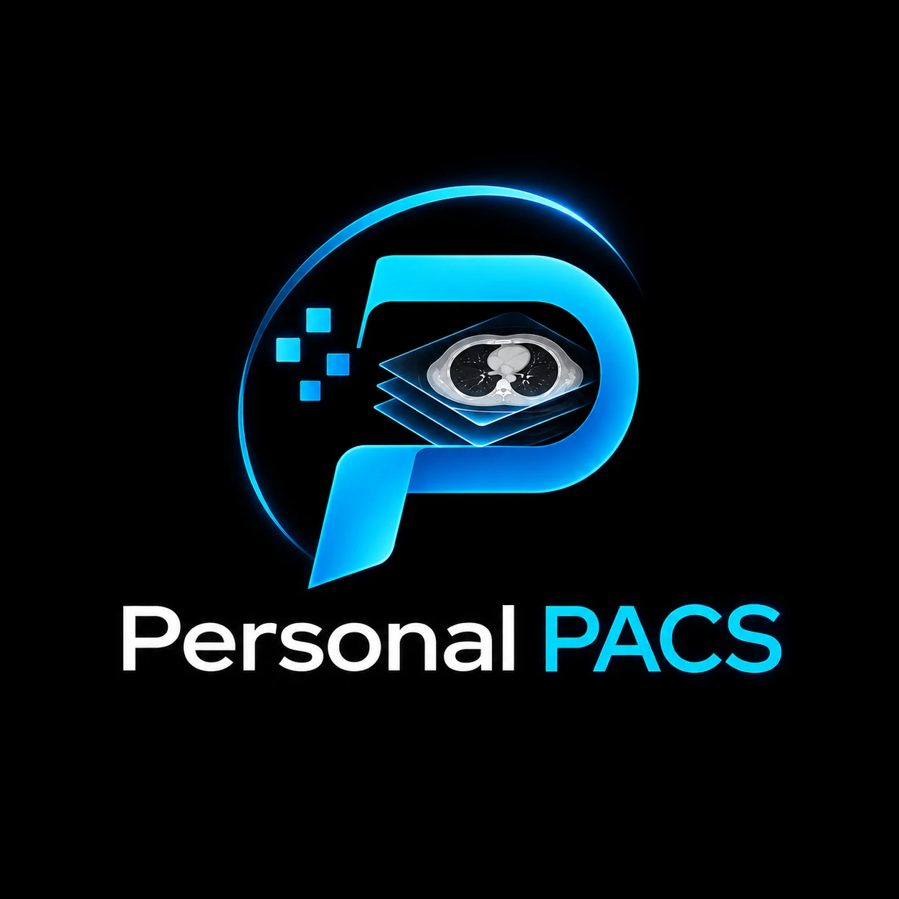

# Personal PACS

<p align="center"></p>

A single-user DICOM viewer and radiology reporting workstation for Windows: import CT, MRI and
other studies from a CD/DVD, USB stick or folder, read them in a PACS-style viewer, and write
reports in a RIS-style editor with templates, macros and PDF/Word export. Everything runs offline on
your own PC or laptop. A companion **Android app** lets you write reports on your phone; it syncs
with the PC over your own Wi-Fi or hotspot. **Case sharing** sends a whole case (images and report)
to another Personal PACS user anywhere on the internet, straight from your PC, encrypted.

> **Not a certified medical device.** Use it for personal reporting workflow, teaching and research.
> Verify findings on your institution's approved diagnostic systems.

## Features

**Worklist**
- Import from a CD/DVD drive, USB stick, folder, individual files or **ZIP archives** (for example a
  study downloaded from a PACS web portal or sent by e-mail), or drag them onto the window.
  Patient CDs with a `DICOMDIR`, files without extensions and ZIPs inside ZIPs work. Password-protected
  ZIPs and RAR/7-Zip archives have to be extracted first (the import says so).
- Images are copied into a local archive, so the CD can be removed. Duplicates are skipped.
- Search by name, patient ID, accession or study. Filter by modality, report status and date.
  Search inside report text, which is handy for teaching files.
- **New Case** lets you report without images. Enter the patient name, CR No (patient ID),
  PG No (accession), age/sex and study, then start reporting. If you import the CD later, images
  with the same PG No attach to that case automatically.
- Patient and study details can be corrected later with "Edit patient / study details" on the report page.

**Reporting window** (laid out like a hospital RIS)
- Patient banner: ID, name/sex/age, study, exam date, visit type, accession, referring doctor.
- Side panels: Scan Status, Clinical Details, Report Last Saved By, and Previous Reports, where you
  can view, copy or PDF the patient's older reports.
- Modality, Procedure, Radiologist, Template Name (with "My Templates") and Macro Text fields.
- Ribbon with Home, Insert, Page Layout, View and Templates tabs:
  - Text formatting: font, size, colour, highlight, bold/italic/underline, sub/superscript and change case.
  - Lists, indents, alignment, line spacing and styles.
  - Find/replace, tables, pictures and symbols.
  - Simple view or print layout, zoom and full screen.
- **Templates**: starter templates include NCCT head, CECT chest, HRCT, CECT abdomen, NCCT KUB,
  MRI brain, LS spine, knee, USG abdomen, chest X-ray and a follow-up comparison template.
  Placeholders such as `{{prior_date}}` are filled in automatically.
- **Macros**: type `.nad` then Space, or the code then F3, or use the Macro Text box.
- **Key images**: press **B** in the viewer to insert the current image, with its measurements, into the report.
- Save (draft), **Preliminary**, **Sign off** and **Sign off »** (signs and opens the next unreported study).
- **Spell check like Microsoft Word**: misspelled words get a red wavy underline (the word you are
  typing is left alone until you finish it). Right-click one for suggestions, **Ignore All** or
  **Add to Dictionary**. About 950 radiology words (hepatomegaly, hypoechoic, pelvicalyceal,
  spondylolisthesis …) are built in, British and American spellings are both accepted (oedema /
  edema), and words in CAPITALS (CECT, USG) are not checked. Works offline. **Settings → Spelling**:
  on/off, British/American, and the words you added.
- Autosave, version history, Print, and export as **PDF**, **Word (.docx)** or **text (.txt)**.
  Exports include your letterhead, logo, patient table and signature.

**Voice dictation** (offline – your voice never leaves the computer)
- Press **F4** in the report, or in the viewer while looking at the images, and speak. The text
  appears in the report after each short pause.
- Runs on the computer's processor with the open-source sherpa-onnx engine. Choose a model in
  **Settings → Dictation**; it downloads once:
  - **Parakeet TDT 0.6B v2** by NVIDIA (460 MB). Recommended, the most accurate for medical words.
  - **Whisper base** by OpenAI (200 MB). Smaller and lighter, but less accurate.
- Voice commands:
  - punctuation: "full stop", "comma", "semicolon", "colon" (at the end of a phrase), "question mark",
    "open/close bracket", "hyphen", "slash"
  - layout and editing: "new line", "new paragraph", "delete that"
  - shortcuts: "macro nad", "template CECT abdomen", "stop dictation"
- "12 by 8 millimeters" is written as "12 x 8 mm". Letters spelled out ("C B D") become "CBD".
- **Corrections list**: if a word is often misheard, add "heard as → write instead" in
  Settings → Dictation.
- A good USB or headset microphone makes a big difference. Windows must allow desktop apps to use
  the microphone (Settings → Privacy & security → Microphone).

**Phone app (Android)** – reporting on the go, synced with the PC
- The same report editor on the phone: templates, macros (`.nad` + space), bold/lists/headings,
  previous reports of the patient, clinical details, and **Save** / **Preliminary**.
  Final **sign-off is done on the PC**; reports signed off there are read-only on the phone.
- **New case** on the phone (patient name, CR No, PG No, age/sex, study …). It appears on the PC;
  when you import the CD there, images with the same PG No attach to it.
- **Mic button** for dictation with Android's speech recognition, using the same voice commands and
  corrections list as the PC. Offline when the phone's offline English speech pack is installed.
- **Export** Word, PDF or text and share it (WhatsApp, Gmail, Drive …) or save it to the phone.
- Works **offline**: cases, templates and macros are kept on the phone. Changes sync automatically
  when the phone and PC are on the same Wi-Fi or hotspot (on opening the app, every minute while it
  is open, and shortly after each change).
- What the phone keeps: every case not yet signed off, everything from the last 30 days, and the
  previous studies of those patients. Older signed-off cases stay on the PC only.
- **Templates and macros sync both ways.** If the same item is changed on both before a sync, the
  newest change wins. For reports the older version is kept in the report's **History** on the PC,
  so nothing is lost.

**Case sharing** – send a case to a colleague's Personal PACS, anywhere
- Select a case and click **Share**. You get a code like `ABCDE-23456` and a ready-to-send message
  with a link. Send it by WhatsApp or e-mail; your colleague clicks **Receive Case** and pastes it
  (or just clicks the link). The images, the report and the clinical details arrive in their worklist.
- **Your PC is the server.** Nothing is uploaded anywhere. It must be on with Personal PACS open
  (minimised is fine) until the case has been downloaded.
- Each time you choose: **keep** the patient's name and ID, or **remove** them. Removing them also
  blanks the birth date, PG No, hospital and doctors in the images, and the patient's name in the report.
- They can **send their report back** to you. It arrives as a **second opinion** on the case,
  and in the report's History.
- The code works for **24 hours** or until you click **Stop sharing**. Watch who downloaded it, and
  how far, in the **Sharing** button on the worklist or under **Settings → Case sharing**.

**Viewer window** (laid out like a hospital PACS, with mouse and hot keys like Fujifilm Synapse; put it on
a second monitor if you have one)
- Study list with prior studies, series thumbnails, and drag-and-drop of series into viewports.
- Layouts 1×1 to 2×3. Double-click a viewport to maximise it (while window/level, zoom, pan or
  dynamic scroll is the mouse tool).
- Right-click opens an image tools menu with presets, tools, scale/rotate/flip, reference lines, tile
  formats, linking, cine, MPR, save and copy. **Holding the right button and dragging zooms** (up =
  in, down = out) around the point you pressed.
- Window/level presets on the **number pad**, with Num Lock on or off: **0 Body Bone**, 1 Body Soft
  Tissue, 2 Body Lung, **3 Body Liver**, 4 original (from the scanner), 5 Head Mid Brain, 6 Head Post
  Fossa, 7 Head Blood, 8 Head Bone, 9 CTA MIP. The menu also has Head IAC, Stroke and Subdural.
- Measurements: length, angle, Cobb angle, ellipse / circle / rectangle / polygon / freehand ROI (mean/SD
  HU, area), probe (HU), bidirectional, text and arrow (right-click › **Annotations**).
- **Spine labels** (key **P**): pick the first level in the small panel (C1 … S5, Co, or the disc
  levels C2-C3 … L5-S1) and click that vertebra. Each further click above or below the labels names
  the next level in order (above L3 → L2, below → L4); a click between two labels fills a gap.
  The labels show in **every plane** of the scan, whichever plane they were placed on: on every
  sagittal and coronal slice at their height (also in the other series of the same scan), and on
  the axial images of their level, where the vertebra is; **axial images also show the level they
  are at** ("Level ≈ L4", or "L4-L5" in the disc space). A sequence started on the sagittal images
  continues on the coronal or axial ones. Drag a label to move it; Delete removes the selected one.
  In the MPR view the crosshair can't be grabbed while labelling, so clicks on its lines place
  labels. Works on X-rays too (then "above" is the top of the screen). Drag the panel by its title
  to move it.
- **Cardiothoracic ratio**: 4 points (both heart borders, then both inner chest walls; the widths
  are measured across the image) or 6 points (two on the midline first; CTR = (MRD + MLD) / chest
  width, measured square to the midline).
- **Save annotations** (key **V**): measurements and labels are kept with the study and come back
  when it is opened again. **Shift+Delete** deletes all annotations on screen (the saved ones stay
  until you save again); right-click › Annotations › **Load Saved Annotations** puts them back.
- Text overlay: patient and series details, W/L, slice location and thickness, kVp/mA, TR/TE,
  plus orientation markers (on X-rays from their Patient Orientation tag; none when it is missing).
- **Compare with prior** (key **C**): current and previous study side by side, with linked scrolling.
- **Coronal / sagittal in the same tile**: **3** shows the coronal view (3 again = back to the original
  axial images), **?** shows the sagittal view (? again = coronal). Window/level is kept. A series
  opened in a tile – thumbnail clicked, or dragged onto any tile including a coronal / sagittal one,
  Alt+S / Alt+A – always shows its own (axial) images; press 3 / ? for its other planes.
- **MPR** (key **M**): axial, sagittal and coronal with crosshairs, plus MIP / MinIP slabs. Opening
  another series while the MPR view is shown leaves the MPR and shows that series' axial images in
  the tile the MPR was started from.
- **MIP / MinIP** (slab menu in the toolbar, or right-click › MIP / MinIP): a thick slab showing the
  brightest values through it (MIP: vessels, nodules) or the darkest (MinIP: airways, emphysema).
  **Ctrl+Shift+wheel** over a tile makes the slab thicker (wheel up: Thin → MIP 2, 3, … 10, 12, …
  100 mm) or thinner (wheel down, back to Thin); a MinIP slab stays MinIP. It applies to that tile –
  coronal / sagittal views, or axial images, which then show as a thick-slab axial view at the same
  level (**Thin** goes back to the original images there) – or, in the MPR view, to all three
  planes. The tile label says which ("CORONAL · MinIP 10 mm"); the slab stays with the tile when you
  switch it between planes (3 / ?).
- **Liver analysis** (toolbar **Liver**, or right-click › Liver Analysis), after the Philips
  IntelliSpace Portal "CT Liver Analysis": axial, 3D, coronal and sagittal views with a step panel.
  1. **Liver** – click once inside the liver (portal venous phase works best) and the whole liver is
     found in 3D; click again on a part that is missing, **Not liver** + click separates an organ it
     ran into (heart, kidney, stomach …), and the **Add / Remove** brushes (a ball of 2–30 mm) correct
     the edge. Undo is kept for the last 6 steps.
  2. **Findings** – click a lesion's centre and drag to its edge: the lesion is segmented in 3D
     (hypo- or hyperdense), with its volume, HU and the segments it lies in; brushes refine it.
  3. **Vessels** – contrast-filled veins in the liver (threshold adjustable). With the landmarks of
     step 4 placed they are sorted into portal and hepatic veins. **Functional liver** = total liver
     minus vessels and findings.
  4. **Segments** – guided landmarks, as in the Philips method (Valette): IVC, right and middle
     hepatic veins, umbilical fissure, right / left portal bifurcation, tip of the left liver and the
     ligamentum venosum, with a schematic showing where each goes. Levels: right / left liver,
     right / left lobe, 4 sectors, 7 segments, 8 (Couinaud) or 9 (Bismuth, 4a / 4b). Volumes as mL,
     % of the total and % of the functional liver.
  5. **Resection** – tick segments to remove (anatomical) and/or draw a cut line and click the side
     to remove, or brush tissue out / back in (atypical). The table gives each part, the total
     resected and the **remnant** (future liver remnant) in mL and % of the total and functional
     liver, coloured below 40 % / 30 %; each finding shows how much of it (with a safety margin) the
     plan removes.
  The 3D view shows the liver or its segments, findings, vessels and the resected part (drag to turn).
  **Send to report** puts the tables plus the 3D and axial pictures into the open report; **Save**
  keeps the whole analysis with the study (it reloads when the series is opened in Liver again, and
  is saved by itself when you leave). Works on built-in graphics (the planes and the analysis run on
  the processor; the 3D view draws surfaces only). Tested on real CT (contrast and non-contrast):
  one click gives a Dice overlap of 0.91–0.96 with reference liver masks.
- **No dedicated graphics card needed**: MPR / coronal / sagittal also run on built-in graphics
  (Intel UHD / Iris, AMD). Windows lets built-in graphics hold only about 128 MB in one piece, so a
  bigger series (for example a 0.625 mm CT with 500+ images) is reformatted **on the processor**
  instead, the way RadiAnt works on modest PCs: every image of the series is used, MIP / MinIP slabs
  and the MPR crosshair (click or drag to move it) work as usual, and the planes are plain images, so all
  measurement tools work on them. Hover the CORONAL / SAGITTAL label to see that a tile is computed
  this way. Smaller series, and any series on a graphics card with enough memory, still use the
  graphics card (which can also rotate the MPR planes). If Windows resets the graphics card anyway,
  the viewer reopens the same study and view by itself and computes such series on the processor
  from then on (remembered for this computer). After three resets in two minutes it stops and
  offers **Try again** (without MPR) and shows the graphics card's name.
- **Scroll bar** on the left of each tile, as on GE / Synapse workstations: its ends show which way the
  slices run (**H**/**F** for axial, **A**/**P** for coronal, **R**/**L** for sagittal). Drag the
  handle or click the bar to move through the images; the image number shows while dragging.
- **Full screen** (**F11**, the toolbar button or the right-click menu): the viewer fills the screen
  and the series strip hides (Alt+E shows it again).
- Cine, invert, rotate, flip and magnifier.
- Compressed DICOM: JPEG, JPEG-LS, JPEG 2000, HTJ2K, RLE and JPEG-XL.

## Install (Windows 10/11)

1. On GitHub, open this repository's **Releases** (right-hand side of the main page) and open
   **Windows app – latest build**.
2. Download and run `PersonalPACS-Setup-x.y.z.exe`. It installs for your user only, so no admin
   rights are needed. `PersonalPACS-Portable-x.y.z.exe` runs without installing.
3. Windows may show "Windows protected your PC" because the app is not code-signed. Click
   **More info → Run anyway**.

### Install the phone app (Android 7 or newer)

1. On your phone, open this repository on GitHub (signed in), go to **Releases → Android app – latest
   build** and tap `PersonalPACS-Android-x.y.z-buildN.apk` to download it. (Or download it on the PC
   and copy it to the phone.)
2. Open the APK. Android asks to allow installing apps from your browser/Files app: allow it.
   If Play Protect warns about an unknown app, choose **More details → Install anyway**.
3. **Updates:** a newer APK installs over the old one and keeps your cases and pairing.
   (Builds made before 9 Nov 2026 used temporary keys: if you installed one of those, uninstall it
   once, then install the new build and pair again. Your reports are safe on the PC.)

### Pair the phone with the PC (once)

1. Connect the phone and the PC to the same Wi-Fi, or connect the PC to the phone's hotspot (most
   reliable: many hospital Wi-Fi networks block devices from talking to each other).
2. On the PC: **Settings → Phone app → Pair a phone…**. A QR code appears. The first time, Windows
   asks whether Personal PACS may use the network: tick **both Private and Public** and click Allow.
3. On the phone: open Personal PACS and tap **Scan QR code** (or **Enter code instead** and type the
   PC address and the 10-letter code shown on the PC).

There is no number or ID to make up: the PC creates its own ID and a secret key, and pairing gives
the phone its own key. The phone finds the PC again by itself when its Wi-Fi address changes.
Everything travels only over your local network, encrypted (AES-256-GCM, key from an ECDH exchange
made during pairing). If a phone is lost, remove it under **Settings → Phone app** on the PC; its key
stops working immediately. Personal PACS must be running on the PC (minimised is fine) for syncing.

## Share a case with a colleague

**Send:** select the case in the worklist (or open it) and click **Share**. Choose whether to keep or
remove the patient's details and whether they may send their report back, then click **Share**.
Click **Copy message** and paste it into WhatsApp, e-mail or SMS. Leave Personal PACS open until the
list shows "downloaded".

**Receive:** click **Receive Case** in the worklist and paste the message, the link or just the
code. Or click the link: a page opens in the browser with **Open in Personal PACS**. The case appears in
your worklist marked "from Dr …". The sender's report becomes your draft, so you can read it, change
it, and click **Send my report to Dr …** in the report's **Sharing** panel.

How it connects, and what is protected:
- First the two PCs try to connect **directly** (peer-to-peer, through home and office routers). If
  that's not possible, the case goes through an **encrypted relay**: Cloudflare's free "quick tunnel".
  The first time, Personal PACS downloads Cloudflare's `cloudflared` tool, once, from Cloudflare's
  official GitHub releases.
- Everything is **encrypted end to end** (AES-256-GCM) with a key made from the code. The key never
  leaves your two computers, so the relay and the peer-to-peer network see only scrambled data.
  Personal PACS never sends the code over the network. In the link it comes after `#`, a part that
  browsers don't send to the website.
- Anyone who has the code can download the case until it stops working, so send it only to the
  person it's meant for. Stop sharing once they have it.
- Removing patient details cannot remove names that are **burned into the pictures** (for example
  some ultrasound images or scanned request forms).
- With only the code, the receiver finds your PC through the peer-to-peer network. If their network
  blocks that, send the whole message, which also contains the link.
- The first time, Windows may ask whether Personal PACS may use the network. Allow it.

## First steps

1. Open **Settings** (gear icon). Enter your name, qualification and registration number. Add your
   signature image and the letterhead (hospital/clinic name, address and logo).
2. In the **Worklist**, click **Import CD / Folder** and choose the CD drive or folder (or
   **Import Files / ZIP** for a ZIP archive).
3. Double-click a study. The report opens and the images open in the viewer window.
4. Choose a template, type or use macros, press **B** in the viewer for key images, then **Sign off**
   and **PDF**, **Word** or **Print**.

### Viewer mouse and shortcuts (Synapse style)

| Mouse / key | Action |
| --- | --- |
| Left-drag | Window/level (left-right = width, up-down = level), or the chosen tool |
| Hold right + drag | Zoom: up = in, down = out (around the point pressed) |
| Hold left + click right | Switch the drag between window/level → zoom → pan |
| Right click | Image tools menu |
| Wheel / middle-drag | Scroll through images |
| Ctrl+Shift+wheel | MIP slab thicker (wheel up) / thinner (down, to Thin); MinIP stays MinIP |
| Scroll bar on the left of the tile | Drag or click to move through the images (H/F, A/P, R/L ends) |
| Double-click the mouse wheel | Link window/level + zoom between tiles |
| Alt+drag / Alt+Ctrl+drag / Alt+Shift+drag | Window/level / zoom / pan |
| Shift+drag / Ctrl+drag | Move / copy a tile (its series, axial / coronal / sagittal view and window) to another tile |
| R T A D | Ruler, text, arrow, density value (HU). One use, then back to window/level |
| G F E H O | Angle, freehand ROI, elliptical ROI, circle ROI, magnifying glass |
| P | Spine labels: pick the first level, click it, then click above / below for the next ones |
| W / Z | Window/level / dynamic scroll (left-drag up or down through the images) |
| Shift+Z / Shift+X | Zoom / pan |
| X / Delete | Eraser / delete the selected measurement |
| V / Shift+Delete | Save the annotations with the study / delete all annotations |
| L / Esc | Lock the tool / back to window/level |
| B | Bookmark: key image into the report |
| S K C J | Linked scrolling on/off, add/remove tile, remove all, auto-link |
| I | Link window/level + zoom between tiles |
| Q / U | Lock / unlock reference lines |
| = / - | Zoom to fit / zoom 1:1 |
| N / M | Cine / MPR |
| Liver (toolbar) | Liver analysis: volume, findings, vessels, segments, resection plan, 3D (Esc drops the liver tool) |
| Number pad 0–9 | Window presets: 0 = bone, 3 = liver, 4 = original (Num Lock on or off) |
| 3 / ? | Coronal / sagittal of the active tile; again = back (3 → axial, ? → coronal) |
| Home / End, PgUp / PgDn, arrows | First / last image, ±10, ±1 |
| F5 | Reset the image |
| Shift+T / Shift+A / Shift+I | Text overlay / annotations / invert |
| Alt+C / Alt+Shift+C / Alt+X | Compare with next / previous prior study, close comparison |
| Alt+S / Alt+A | Next / previous series |
| Alt+I / Alt+N / Alt+R / Alt+E | Study info / notes / report / series picker |
| Ctrl+C | Copy the image to the clipboard |
| F4 | Dictation on/off |
| F11 | Full screen on/off |

## Your data

- Default data folder: `%LOCALAPPDATA%\PersonalPACS\Data`. It holds the database (`pacs.db`) and
  the `archive` of images. You can move it in **Settings → Data**, for example to a bigger D: drive.
- **Back up regularly:** **Settings → Back up reports database** saves a copy of all reports.
- The archive contains patient data. Keep it out of OneDrive/Dropbox and turn on BitLocker on laptops.
- The phone app keeps its copy in the app's private storage and is excluded from Android cloud
  backups. Use a screen lock on the phone. **Settings → Unpair** on the phone removes everything from it.

## Development

Requirements: Node.js 22 or later.

```bash
npm install
npm run dev        # run with hot reload
npm run typecheck
npm run build      # production build into out/
npm run dist:win   # Windows installer + portable exe into dist/ (run on Windows)
```

The Electron binary downloads on the first `npm run dev`.

Phone app (Capacitor 8; screens in `src/mobile`):

```bash
npm run mobile:dev          # the phone screens in a browser (use a phone-sized window)
npm run android:sync        # build the screens and copy them into android/
cd android && ./gradlew assembleRelease   # APK (needs JDK 21 and the Android SDK)
```

GitHub Actions builds the APK and the Windows installer on every push and publishes them as the
**android-latest** and **windows-latest** releases (only the newest build is kept).
`python scripts/make-icons.py` makes every icon (Windows, Android, app screens) from `build/logo.webp`.

**Android signing key.** Android installs an update only when it is signed with the same key as the
installed app. The permanent release key is kept in this **private** repository
(`android/app/personalpacs-release.jks`, password in `android/keystore.properties`), so every build
installs over the previous one. Keep the repository private: anyone with the key could sign an
"update" for the app. If the repository ever becomes public, move the key out first.

Test data: `scripts/make_test_data.py` generates synthetic, anonymous CT/MR studies. These include a
prior study, compressed series and a CD layout with DICOMDIR.

```bash
pip install pydicom numpy pylibjpeg pylibjpeg-openjpeg pyjpegls
python scripts/make_test_data.py test-data
```

### How it is built

- **Electron**, with React and TypeScript, built with electron-vite.
- **Cornerstone3D** (MIT) handles image decoding, GPU rendering, tools and MPR.
- **TipTap** (MIT) is the report editor.
- **Spell check**: nspell (MIT) with the Hunspell English dictionaries from wooorm/dictionaries
  (`dictionary-en`, `dictionary-en-gb`; MIT and BSD, based on SCOWL), run in a web worker
  (`src/renderer/src/ris/spell/`). The radiology word list is `src/shared/medicalWords.ts`.
- **SQLite** is the database, using Node's built-in `node:sqlite`, so there are no native modules to compile.
- **dicom-parser** reads headers during import.
- **sherpa-onnx** (Apache-2.0) runs offline speech recognition, using Silero VAD to split speech into
  phrases. It runs in an Electron utility process (`src/main/speechWorker.ts`), so it can't freeze or
  crash the app. Models download from the sherpa-onnx GitHub releases.
- `src/renderer/src/ris/dictation.ts` holds the microphone capture, voice commands and text tidying.
- `src/main`: database, import, archive protocol (`app://bundle/dicom/...`), print/PDF and IPC.
- `src/preload`: the `window.api` bridge.
- `src/renderer/src/ris`: worklist, report page, templates and settings.
- `src/renderer/src/viewer`: the viewer window.
- **Reformatting on the processor** (`src/renderer/src/viewer/reformat.ts`): Cornerstone's MPR
  uploads a series as one 3D texture (2 bytes per voxel where the card filters 16-bit textures,
  otherwise 4), and Direct3D 11 only guarantees max(128 MB, ¼ of the card's dedicated memory) per
  texture. Series above that (`reformatOnCpu` in `cs.ts`) are kept in ordinary memory instead; each
  axial / coronal / sagittal image (and MIP / MinIP slab) is computed when it is shown and displayed in a
  normal stack viewport through a `pacsmpr:` image loader and metadata provider.
- **Phone sync**: `src/main/phoneLink.ts` is a small HTTP server on the local network (port 47820,
  UDP 47821 for discovery) that only answers paired phones. `src/shared/syncCrypto.ts` holds the
  pairing and encryption code shared by both sides. The database records a revision number on every
  change (SQLite triggers), so the phone asks for "everything since revision N".
- **Exports**: `src/shared/reportExport.ts` makes the Word and text files on both the PC and the
  phone. The phone makes PDFs with pdfmake (`src/mobile/reportPdf.ts`); the PC uses Chromium.
- **Case sharing** (`src/main/share/`): `host.ts` serves a shared case, `client.ts` receives it.
  The case's files are read as one stream in 4 MB chunks (`pack.ts`), each encrypted on the fly; when
  anonymizing, identifying DICOM values are overwritten in place with values of the same length
  (`anonymize.ts`), so the image data and file layout don't change. A 10-character code goes
  through scrypt to make the encryption key, the request-signing key and a HyperDHT key pair
  (`crypto.ts`). The direct connection is HyperDHT (Holepunch: public DHT plus UDP hole punching,
  `dht.ts`, framed requests in `rpc.ts`). The relay is a Cloudflare quick tunnel to a local server
  (`tunnel.ts`); its address is published, encrypted, in the DHT under the share's key. Links use the
  `personalpacs://` protocol, registered by the installer.
- **Phone app**: React + TipTap (sharing the PC's editor code) in a Capacitor Android shell. The
  phone keeps its data in IndexedDB (`src/mobile/db.ts`) and syncs with `src/mobile/sync.ts`. Two
  small native plugins live in `android/app/src/main/java/com/personalpacs/mobile/`: `LanPlugin`
  (find the PC by UDP broadcast) and `DictationPlugin` (continuous Android speech recognition).

## Roadmap ideas

- Receive studies straight from scanners/PACS (DICOM C-STORE), and query/retrieve.
- Anonymised export of teaching cases to a folder or USB stick.
- Custom medical vocabulary boosting for dictation.
- 3D volume rendering and hanging protocols.
